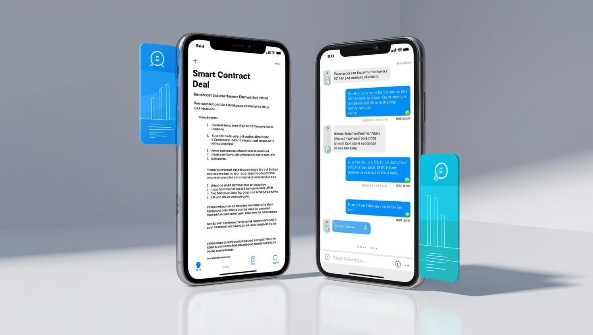

# Athlete's Vault — NIL Payments and Wealth Management for Student-Athletes

A venture project from an **Entrepreneurship and New Ventures** course: the business case, financial model and technical architecture for a platform that pays student-athletes on time for NIL deals and helps them keep the money afterwards.

I was the **CTO on the founding team**, responsible for the system architecture, the AI valuation model and the smart-contract payment design.



## The problem

NIL (Name, Image, Likeness) rules let college athletes earn from sponsorships for the first time. The money arrived; the infrastructure did not.

- Contracts are unclear and promises get broken
- Payments are delayed or disputed
- Compliance spans NCAA rules **and** different state laws
- **78% of athletes face serious financial difficulty after their playing career ends** — short earning windows with no financial structure around them

So the problem is not only *getting paid*. It is getting paid **reliably**, and turning a short income spike into long-term stability.

## The solution

| Feature | How it works | Problem it solves |
| --- | --- | --- |
| **Smart-contract payments** | Deal terms on Polygon; payment releases automatically when conditions are met | Late and disputed payments; creates an auditable record |
| **AI NIL valuation** | A model estimates fair market value from athlete and market data | Athletes can't tell whether an offer is fair |
| **Dual-slider negotiation** | Athlete sets minimum and ideal; brand sets maximum and preferred. Overlap → a recommended fair price; no overlap → AI suggests adjustments from comparable deals | Negotiation without an agent taking a cut |
| **Automated savings (FIA)** | A share of each payout flows into a Fixed Index Annuity: tax-deferred growth with downside protection | Income disappears without a savings mechanism |
| **Compliance monitoring** | Checks deals against NCAA and state rules; tax automation | Eligibility risk from rule breaches |
| **Fraud detection** | Flags suspicious deals against market patterns | Predatory offers aimed at young athletes |

The **dual-slider engine** is the piece I am most pleased with. Instead of haggling, both sides state a private range; the system only reveals a price when the ranges overlap, and recommends a fair settlement inside the overlap. Neither side has to open with a number.

## Technical architecture

```
React Native app  →  Flask API  →  scikit-learn valuation model
       │                 │
   Firebase /        Polygon smart contracts
   Firestore         (MetaMask wallet, Alchemy/Infura)
```

| Layer | Technology | Role |
| --- | --- | --- |
| Mobile | React Native + Firebase | Athlete and brand app, real-time updates |
| Backend | Python Flask API | Deal logic, AI prediction endpoints |
| ML | scikit-learn | NIL valuation and fraud scoring |
| Blockchain | Polygon smart contracts | Escrow and automatic payment release |
| Database | Firebase / Firestore | Users, deals, transactions |
| Deployment | Expo/EAS (mobile), AWS/Heroku/GCP (API), Polygon (contracts) | |

**Why blockchain here, and not a normal payments API:** the value is not the currency, it is that the contract terms and the payment trigger live in the same auditable object. A compliance officer can verify what was agreed and what was paid without trusting either party's records. A traditional escrow service could do this too, with a trusted intermediary and lower complexity — that trade-off is discussed in the deck.

## Testing and rollout plan

- **Unit tests** on the pricing slider and the prediction API
- **End-to-end tests** of real athlete and sponsor workflows
- **Security tests** on access control and wallet transactions
- Phased rollout: MVP (profiles, deal tracking, payments, basic valuation) → growth (negotiation engine, sponsor marketplace, compliance and tax automation) → scale (university partnerships, more financial products, international)

## Repository layout

```
docs/Athlete_Vault_Presentation.pdf   the full 36-slide investor deck
docs/NIL_Wealth_Financials.xlsx       financial model and projections
docs/startup_brainstorm.docx          early concept exploration
images/                               app concept mockups and cost-breakdown graphic
```

## Team

| | |
| --- | --- |
| Manasseh Small | CEO, co-founder |
| Josh Vogt | CFO, co-founder |
| **Nikhil Chhatraband** | **CTO** — architecture, AI valuation, smart-contract design |
| Miles Jordan | Athlete relations, legal and compliance |
| Dave McDaniel III | Financial strategist |

## What I took from it

Building the architecture was the straightforward part. The hard part was the **constraint stack**: NCAA rules, state law, tax treatment and athlete financial literacy all shape the product more than the technology does. A payment system that is technically perfect but fails a compliance check is worthless to the user it was built for.

---
**Author:** Nikhil Chhatraband · Entrepreneurship and New Ventures, Master's in Data Science
*Sources used in the deck: Opendorse annual report, On3 NIL valuations and rankings, published NIL deal reporting.*
